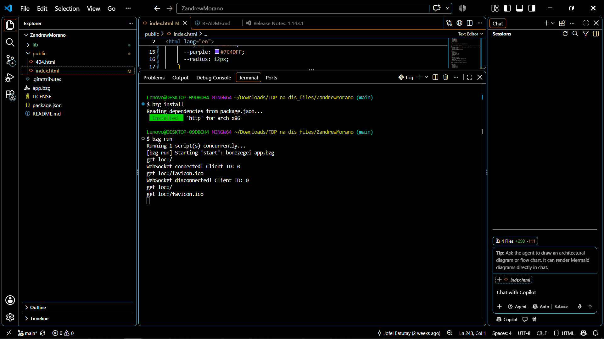
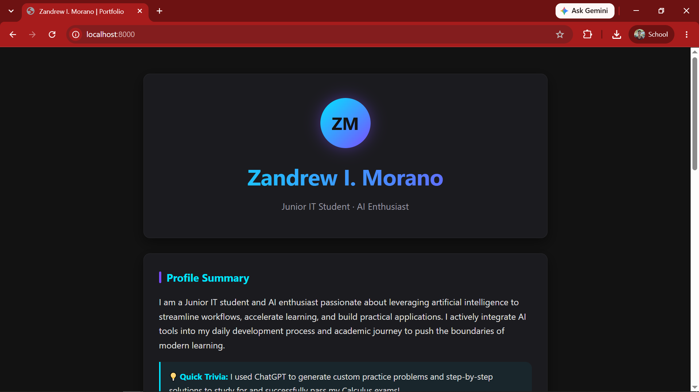

# Personal Portfolio Landing Page

**CCC181: Application Development and Emerging Technologies, Laboratory 1: Static Webpage**

## Project Description

This project is the personal portfolio landing page of **Zandrew I. Morano**, a Junior IT student and AI enthusiast. The page presents a profile summary, skills and technologies, projects and achievements, and contact/social links.

It is a single static HTML file with embedded CSS, styled with a modern, minimalist dark theme (charcoal background, cyan and electric purple accents, rounded card sections) and a responsive, centered single-column layout.

### Tech Stack

| Layer | Technology |
|-------|------------|
| Front end | HTML5 and CSS3 (embedded in `index.html`) |
| Web server | Bonezegei Scripting Language (BSL) v1.3.3 HTTP Web Server framework |
| Tooling | Visual Studio Code, Git, GitHub |

## Setup & Execution Steps

### Prerequisites

- **Bonezegei Scripting Language v1.3.3**
  - **Windows:** Open the Microsoft Store, search for "Bonezegei Scripting Language", and install/update to v1.3.3.
  - **Linux / GitHub Codespaces:**
    ```bash
    wget https://github.com/bonezegei/Bonezegei_Scripting_Language/raw/refs/heads/main/Release/Latest/Bonezegei-x86.deb
    sudo apt install ./Bonezegei-x86.deb
    bonezegei -v
    ```
- **Visual Studio Code** with the *Bonezegei Scripting Language Formatter* extension (Extensions: `Ctrl+Shift+X`, search "bonezegei").

### Steps

1. **Clone the repository**
   ```bash
   git clone https://github.com/ZforZan/<your-repository-name>.git
   cd <your-repository-name>
   ```
2. **Open the project in VS Code**
   ```bash
   code .
   ```
3. **Open the integrated terminal** (`` Ctrl+` ``) in the project directory.
4. **Install dependencies**
   ```bash
   bzg install
   ```
5. **Run the web server**
   ```bash
   bzg run
   ```
   Alternatively, click the **Run** button provided by the BSL VS Code extension.
6. **Open the app in your browser** at **http://localhost:8000**

To stop the server, press `Ctrl+C` in the terminal.

## Execution Verification

### Terminal Output (`bzg run`)

<!-- Replace the path below with your actual screenshot file -->


*Screenshot showing `bzg run` executing without errors.*

### Browser Rendering

<!-- Replace the path below with your actual screenshot file -->


*Screenshot showing the portfolio landing page rendered at `http://localhost:8000`.*

## License

This project is licensed under the **MIT License**. See the [LICENSE](LICENSE) file for details.